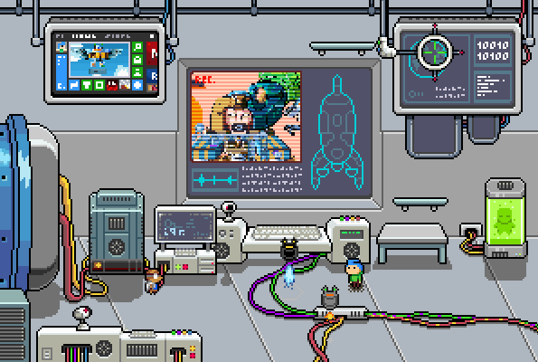
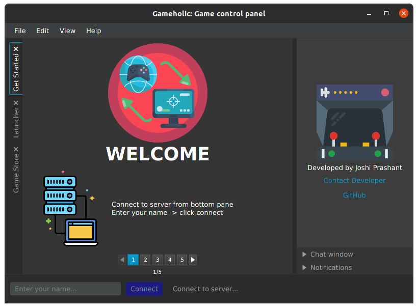

# Gameholic

A desktop platform where developers build two-player Java games once and get **online multiplayer for free**. Gameholic has two parts:
- a JavaFX **control panel** that launches games and creates or joins online sessions;
- a **relay server** that pairs players and forwards game data between them.

I built it in 2021 as the first real consumer of my networking library, **[JavaServerClientAPI (JSC)](https://github.com/pj-25/JavaServerClientAPI)**.

> **Status:** historical project (June–Nov 2021, JDK 8 + JavaFX), kept for reference. The relay was re-verified in 2026 with an automated two-client smoke test. The 2021 hosted server, an AWS EC2 instance, is offline, so run the server locally.



Video walkthroughs (2021): [English](https://synthesia-ttv-data.s3-eu-west-1.amazonaws.com/video_data/6b690c58-ae0f-4fc8-9ac7-9bf7a2a3569e/transfers/target_transfer.mp4) · [Hindi](https://synthesia-ttv-data.s3-eu-west-1.amazonaws.com/video_data/881a5203-2f03-427a-b524-ac65855277a9/transfers/target_transfer.mp4) · [JavaDocs](https://pj-25.github.io/Gameholic/docs)

## Why
Each multiplayer game I wrote, such as tic-tac-toe or a ball game, re-implemented the same pieces: sockets, lobbies, "send my move to the other player". Gameholic moves all of that into a platform:
- a game only implements its own rules and UI;
- it sends moves through `GameManager`;
- it receives the opponent's moves as events.

## Architecture
```
 Player A (control panel + game)            Gameholic server             Player B
 ───────────────────────────────            ────────────────             ────────
 GameManager ──CREATE_GSESSION(game,name)──▶ PlayerConnection (1 per client, JSC JRequestManager)
             ◀──────── session id ──────────  GameSession{creator, opponent}
                                             ◀──JOIN_GSESSION(id,name)──── GameManager
             ◀──START_GAME(game, "B")──────  ──START_GAME(game, "A")─────▶
             ──PASS_DATA(move)─────────────▶ relays to the competitor ────▶
             ◀──────────────────────────────  ◀──PASS_DATA(move)─────────
                                             END_GSESSION / GAME_OVER / PLAYER_DISCONNECTED
```
| Module | Role |
|---|---|
| `gameholic/server` | `GameholicServer` starts a JSC `JServer`. Each client gets a `PlayerConnection`, which decodes `GameControlEvent`s (create, join, pass data, end, game over) and routes them to the right `GameSession`. |
| `gameholic/gameManager` | The client-side SDK that games link against. It owns the `JConnectionManager` and event bus, and holds player names, game mode (online or offline) and session id. |
| `gameholic/src` (control panel) | The JavaFX app: connect, a launcher (pick game, mode, play), and a notification pane for join invites. Games are loaded from jars in `src/gameholic/games`. |

### Design decisions and their limits (as built in 2021)
- **The server relays; it doesn't simulate.** It forwards moves without understanding them, so adding a game needs no server change. The cost is that the server can't validate moves, so clients are trusted.
- **Sessions live in memory** in a static `HashMap` shared by every connection thread. That's fine for a demo, but it isn't thread-safe and is lost on restart. Today I'd use a `ConcurrentHashMap` with expiry, or a store such as Redis.
- **Session IDs are predictable:** `game_creator_hashCode`. Anyone who learns one can join, and joining a full session replaces the opponent. A v2 would use random IDs and reject the join once both seats are taken.
- **Two players per session**, fixed by the protocol (`CREATOR` / `OPPONENT`).
- **Planned but never implemented:** the in-app *chat window* and *game store* exist only as UI layouts; their classes are empty stubs.
- The client has the 2021 server address hard-coded in `GameManager.connect()`. Point it at your local server to play online.

## Verify the relay (no IDE needed)
You need JDK 8+ and a sibling checkout of JSC, which is the layout the IntelliJ project expects:
```sh
git clone https://github.com/pj-25/JavaServerClientAPI ../JavaServerClientAPI
scripts/smoke-test.sh
```
The smoke test starts a real server on a free port and connects two real clients. It checks:
- create → session id;
- join → `START_GAME` on both sides with the opponent's name;
- `PASS_DATA` relayed in both directions;
- an unknown session id → `INVALID_SESSION_ID`.

## Run the control panel (2021 workflow)
Open `gameholic/` in IntelliJ IDEA with JDK 8 plus JavaFX, or run the prebuilt [gameholic.jar](gameholic/out/artifacts/gameholic_jar/gameholic.jar). Then:
1. **Connect:** enter a name and click Connect.
2. **Launcher:** select a game, then a mode, then Play.
   - **Online:** *Create* gives you a session id to share, and the other player clicks *Join* with that id.
   - **Offline:** enter both names and click Start.



## History
- 2021-06-15: started, as the proof of concept for JSC.
- 2021-06 → 11: control panel, session protocol, launcher, notifications, docs.
- 2026: README rewritten from the code. The relay smoke test was added, and the server and features advertised in 2021 were checked against the source (the chat window and game store turned out to be stubs).
